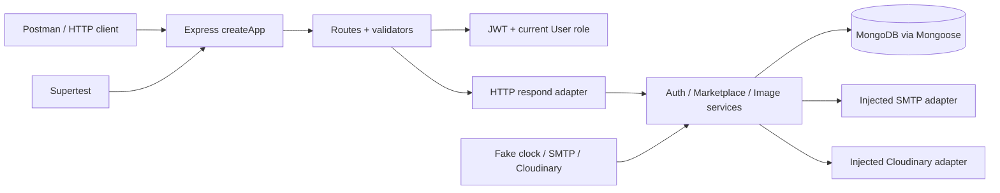
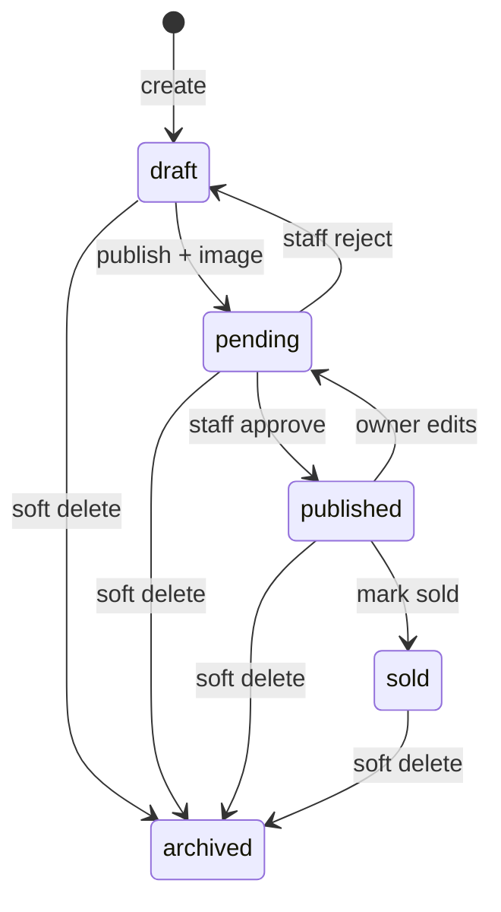

# Architecture Overview

> **Source basis:** Instructor-provided Project 01 README. The public page was checked, but the application source files and tests could not be independently inspected. Implementation details listed here reflect the README; any example not described in the README is explicitly illustrative.

## Core component graph

## Layer ownership

| Layer | Responsibility | Avoid |
|---|---|---|
| `server.js` | Connect DB, bind listener, graceful shutdown | Business logic |
| `app.js` | Register middleware, routes, error handling | Opening listener during test import |
| `routes/` | Method/path and policy composition | Raw persistence logic |
| `validators/` | Normalize/limit external input | Authorizing by client-supplied role |
| `middleware/auth.js` | Verify token, load current User, check role | Trusting stale token role claims |
| `controllers/http.js` | Adapt service results to `{data: ...}` | Domain state transitions |
| `services/` | Invariants, scoped reads, conditional writes, compensation | HTTP transport details everywhere |
| `models/` | Schemas, refs, indexes, concurrency | Replacing service authorization |
| provider adapters | SMTP/Cloudinary SDK integration | Tangling provider credentials with controllers |
| final errors | Stable safe `{error: ...}` | Leaking raw provider errors |

## Marketplace state machine

See [Database](../01-API-and-System-Topics/14-Database-Models-and-Indexes.md), [Listings](../01-API-and-System-Topics/04-Ads-and-Listing-Lifecycle.md), and [RBAC](../01-API-and-System-Topics/11-Security-RBAC-and-Ownership.md).
