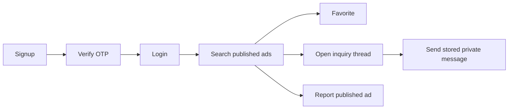
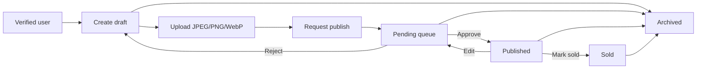

# Marketplace Business Flows

> **Source basis:** Instructor-provided Project 01 README; repository source code was not independently inspected.

## Who can do what?

| Persona or role | Relationship | Actual persisted role | Common operations |
|---|---|---|---|
| Buyer persona | Inquires about another user's ad | `user` | Browse, favorite, private inquiry, report |
| Seller persona | Owns a listing | `user` | Draft, upload, publish request, edit, sold, archive |
| Moderator | Staff | `moderator` | User capabilities plus pending-ad/report moderation |
| Administrator | Staff | `admin` | Moderator capabilities plus user/category and cleanup administration |

**Important:** Seller is **ownership**, not a separate privileged role. The same account can sell a phone and inquire about another user's bicycle.

## Buyer journey

### Request order

1. `POST /api/auth/signup` and `POST /api/auth/verify`.
2. `POST /api/auth/login` to obtain a bearer token.
3. `GET /api/ads` using public filters.
4. Optional `PUT /api/favorites/:id` for a published nondeleted listing.
5. `POST /api/conversations` to open/reuse an inquiry thread (exact body key: verify in validators/Postman).
6. `POST /api/conversations/:id/messages` to store an inquiry; only participants can read/send.
7. `POST /api/reports` for inappropriate public content, at most one report per reporter/listing.

**Not implemented:** Purchase order, payment, checkout, bargaining workflow, delivery, WebSocket delivery.

## Seller journey

### Invariant checklist

- The owner is the authenticated User ID, not a request body field.
- Initial status is draft; it is not legal to PATCH status to published.
- Publishing requires at least one uploaded image.
- Pending ads are reviewed by moderator/admin before public exposure.
- Published field/media changes return to pending.
- Only published and not-deleted ads appear in public discovery.
- Archived is a soft-delete state and releases category reference; it is not data erasure.

## Moderator flow

`Staff login → GET /api/moderation/ads → approve/reject pending ad → GET /api/moderation/reports → resolve`.

A moderator cannot mutate user roles, administer categories, or run admin cleanup. Every decision should be conditional on the current pending state to reject simultaneous stale decisions.

## Administrator flow

`Verify account → local promotion script → login → manage users → manage categories → moderate → recover cleanup`.

The bootstrap script promotes only an existing verified user. Admin user management cannot target the current actor. Current database role is checked on every authenticated request.

## End-to-end class demo

1. Register a seller and buyer, verify both, and promote a third verified administrator.
2. Admin creates category; seller creates draft; public GET cannot find draft.
3. Seller uploads valid image and requests publication; moderator approves.
4. Buyer searches, favorites and opens a private inquiry; third-party user cannot inspect thread.
5. Buyer reports; moderator resolves.
6. Seller marks sold and archives; public search and favorites no longer reveal it.
7. Show failure paths: OTP replay, wrong role, wrong owner, invalid transition, fake upload, private conversation ID.

See the individual topic guides for request shapes, specific limits and tests.
