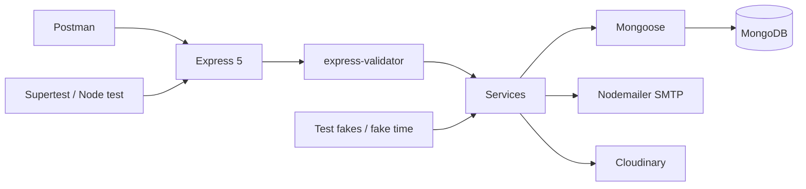

# Complete Technology Stack

> **Source basis:** Instructor-provided Project 01 README; repository source code was not independently inspected.

## Runtime, API and persistence

| Component | Version claimed in README | How it is used |
|---|---|---|
| Node.js | 24 (`>=24 <25`) | ESM runtime, crypto, signals, test runner |
| Express | 5.1 | Routing, middleware, JSON parser, async errors |
| MongoDB | Not pinned here | Document database |
| Mongoose | 8.24 | Schemas, references, indexes, queries, optimistic concurrency |
| JSON Web Token | Version not stated | HS256 access tokens, one-day expiry |
| bcrypt | 6 | Password hashing/comparison, cost factor 12 |
| Nodemailer | 10 | SMTP OTP delivery |
| Cloudinary | 2.7 | Hosted image upload and deletion |
| Multer | 2.4 | Bounded in-memory multipart uploads |
| express-validator | 7.3 | Request body, param and query validation |
| file-type | 21.3 | Detect image signatures from bytes |
| Supertest | 7.1 | In-process HTTP integration tests |
| MongoDB Memory Server | 10.2 | Disposable test MongoDB |
| Node built-in test runner | Included in Node | Test execution and lifecycle |
| Postman | Tool, no version asserted | Manual API journeys |

These versions are **claims from the supplied README**, not a lockfile inspection. Consult the actual `package.json` and `package-lock.json` before publishing as package-verified.

## Why these pieces are separate

- **Express** manages the HTTP lifecycle; it does not by itself ensure authorization or database integrity.
- **Mongoose** models data constraints and query operations; its indexes are a second line of defense against concurrency races.
- **JWT** provides signed identity; current permissions are loaded from User in MongoDB.
- **bcrypt** stores a slow password hash; **HMAC OTP** uses separate `OTP_SECRET` and is not password hashing.
- **Nodemailer** delivers codes to the configured SMTP service; **Cloudinary** stores listing assets.
- **Multer** enforces transport dimensions; **file-type** checks actual image bytes.
- **Supertest + Memory Server** exercise the real HTTP and persistence layers while dependency injection replaces external providers/time.

## Layer-to-tool map



## Useful development commands

```bash
node --version
npm ci
cp .env.example .env
npm start
npm run dev
npm test
npm run admin -- verified-user@example.test
```

`npm start` and `npm run dev` are alternatives. Read `.env.example` and configure required runtime secrets and services first. **Never commit `.env` or exported Postman secrets.**

## Future infrastructure, not current dependencies

React/Next.js frontend, payment processing, WebSocket delivery, shared rate-limit datastore, background job queue, Docker deployment, CI/CD pipeline, metrics/traces and monitoring are not present in this source description.
