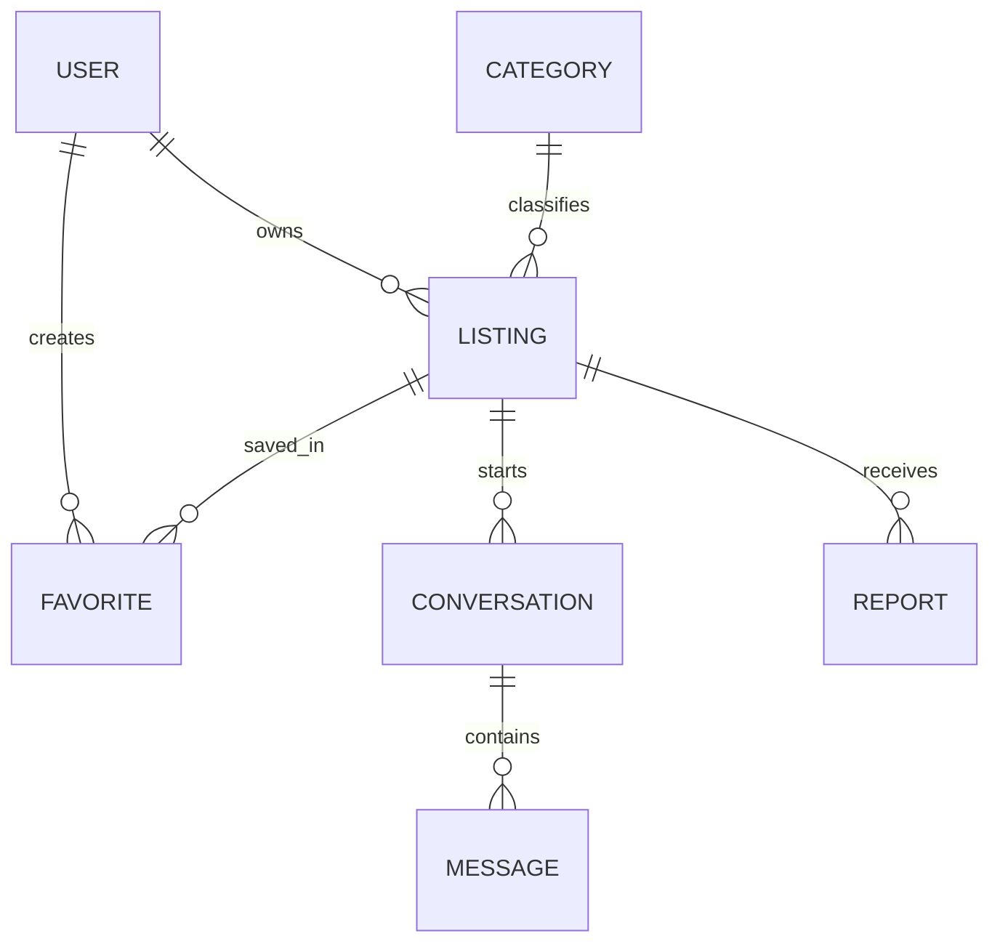

# Database Models and Indexes

> **Source basis:** Instructor-provided Project 01 README. The public page was checked, but the application source files and tests could not be independently inspected. Implementation details listed here reflect the README; any example not described in the README is explicitly illustrative.

## Goal

Eight Mongoose models, relationship semantics, secrecy rules, uniqueness, state, concurrency and category-count reservations.

## How the implementation works

1. Start with User identity and Category taxonomy.
2. Connect Listing to User owner and Category; embed Cloudinary metadata and lifecycle state.
3. Create Favorite as unique user/listing join.
4. Create Conversation unique buyer/listing; Message links sender and conversation.
5. Track one Report per reporter/listing and resolution status.
6. Persist Cleanup by unique provider publicId when asset deletion fails.
7. Inspect `select:false` for secrets, query indexes, and optimistic version behavior.
8. Run concurrent and failure tests for index and reservation guarantees.

## Invariants and exact boundaries

- `User.email` unique and normalized; password/OTP hidden.
- `Category.slug` and `(name,parent)` unique; hierarchy max one child level.
- `Favorite(user,listing)` and `Conversation(buyer,listing)` unique.
- `Report(reporter,listing)` unique; `Cleanup(publicId)` unique.
- Listing optimistic concurrency protects embedded gallery metadata.
- No transaction covers MongoDB and Cloudinary; compensation/reconciliation needed.

## Database responsibilities

- User → many Listing; User → many Favorite/Report/Message.
- Category → many Listing, Category → direct child Category.
- Listing → many Favorite/Conversation/Report.
- Conversation → many Message.
- Cleanup is operational state for provider deletion; not a buyer/seller domain model.

## Request or design example

This diagram is a conceptual relationship view; full index definitions must be verified in `src/models/index.js`.

## Verification checklist

- [ ] Attempt duplicate email/favorite/conversation/report/cleanup keys.
- [ ] Read default user projection; ensure password/OTP are hidden.
- [ ] Stale Listing.save causes version conflict.
- [ ] Category deletion while references/children exist.
- [ ] Message query uses conversation/newest index, listing search uses public status index.

## Common mistakes

- Believing Mongoose `unique` alone is friendly app-level validation.
- Saving whole image binary to MongoDB.
- Embedding all messages in Conversation.
- Using User.role for buyer vs seller personas.

## Practical assignment

Draw all eight models, list fields that should never leave the server, and explain four different concurrency safeguards: unique index, conditional write, category counter reservation, and optimistic version.

## Source files to inspect

- `src/models/index.js`
- `src/services/auth.js`
- `src/services/marketplace.js`
- `src/services/images.js`
- `tests/core.test.js`

## Cross-reference

See [documentation index](../README.md), [project review](../00-Start-Here/01-Project-Review.md), and [API inventory](../03-Reference/01-Complete-API-Inventory.md).
