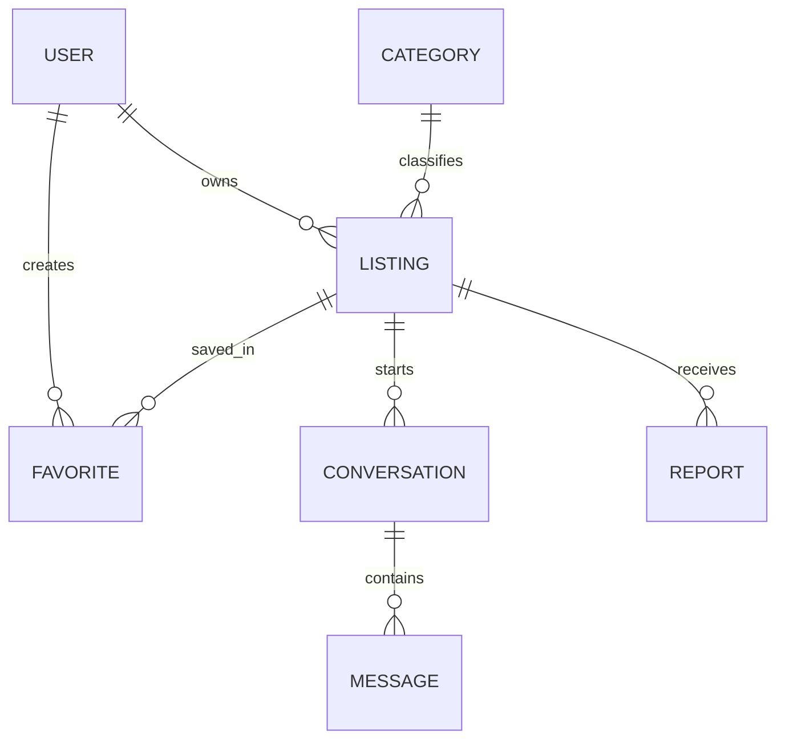

# Database Models and Indexes

> **Source basis:** Instructor-provided Project 01 README. The public page was checked, but the application source files and tests could not be independently inspected. Implementation details listed here reflect the README; any example not described in the README is explicitly illustrative.

## Goal

Eight Mongoose models, relationship semantics, secrecy rules, uniqueness, state, concurrency and category-count reservations.

## How the implementation works

1. Start with User identity and Category taxonomy.
2. Connect Listing to User owner and Category; embed Cloudinary metadata and lifecycle state.
3. Create Favorite as unique user/listing join.
4. Create Conversation unique buyer/listing; Message links sender and conversation.
5. Track one Report per reporter/listing and resolution status.
6. Persist Cleanup by unique provider publicId when asset deletion fails.
7. Inspect `select:false` for secrets, query indexes, and optimistic version behavior.
8. Run concurrent and failure tests for index and reservation guarantees.

## Invariants and exact boundaries

- `User.email` unique and normalized; password/OTP hidden.
- `Category.slug` and `(name,parent)` unique; hierarchy max one child level.
- `Favorite(user,listing)` and `Conversation(buyer,listing)` unique.
- `Report(reporter,listing)` unique; `Cleanup(publicId)` unique.
- Listing optimistic concurrency protects embedded gallery metadata.
- No transaction covers MongoDB and Cloudinary; compensation/reconciliation needed.

## Database responsibilities

- User → many Listing; User → many Favorite/Report/Message.
- Category → many Listing, Category → direct child Category.
- Listing → many Favorite/Conversation/Report.
- Conversation → many Message.
- Cleanup is operational state for provider deletion; not a buyer/seller domain model.

## Request or design example



This diagram is a conceptual relationship view; full index definitions must be verified in `src/models/index.js`.

## Annotated implementation examples (read alongside the real source)

> **Important:** These are newly written, commented **teaching implementations based on the supplied README**, **not recovered source code**. The published site did not expose the repository source for verification. Do not paste every example into one source file: overlapping snippets such as schema declarations are meant to be studied individually, then reconciled with your codebase. Each snippet identifies its intended source path and explains the business rule it demonstrates.

### User schema, private fields and OTP state

**File illustrated:** `src/models/index.js` · **Status:** annotated reference example, **not a verbatim extract** from the unavailable repository.

```javascript
import mongoose from 'mongoose';
const { Schema, model } = mongoose;

// REFERENCE FIELD NAMES: align with your actual repository before copying.
const userSchema = new Schema({
  name: { type: String, required: true, trim: true },
  email: { type: String, required: true, lowercase: true, unique: true },
  password: { type: String, required: true, select: false }, // hide password hash
  role: { type: String, enum: ['user', 'moderator', 'admin'], default: 'user' },
  active: { type: Boolean, default: true },
  verified: { type: Boolean, default: false },
  profile: {
    city: { type: String, trim: true },
    phone: { type: String, trim: true },
  },
  otp: {
    hash: { type: String, select: false }, // never return the HMAC
    expiresAt: Date,
    sentAt: Date,
    attempts: { type: Number, default: 0 },
  },
}, { timestamps: true });

// 'unique' creates an index; translate duplicate-key errors to HTTP 409.
export const User = model('User', userSchema);
```

**Why this code exists:** Only safe fields are normally selected, and the database enforces unique emails.

**Try it:** Register twice with differently cased versions of the same email; expect a duplicate-key conflict, not two accounts.

**Before using in production:** Compare model property names, imports, validation, error types, and route signatures against the real Project 01 source. This excerpt teaches the documented invariant; it may omit neighboring middleware or application wiring.

### Categories with bounded hierarchy and reservation counters

**File illustrated:** `src/models/index.js` · **Status:** annotated reference example, **not a verbatim extract** from the unavailable repository.

```javascript
import mongoose from 'mongoose';
const { Schema, model } = mongoose;
const categorySchema = new Schema({
  name: { type: String, required: true, trim: true },
  slug: { type: String, required: true, unique: true },
  parent: { type: Schema.Types.ObjectId, ref: 'Category', default: null },
  active: { type: Boolean, default: true },
  // Counters protect against deleting a category during new references.
  references: { type: Number, default: 0, min: 0 },
  children: { type: Number, default: 0, min: 0 },
}, { timestamps: true });
categorySchema.index({ name: 1, parent: 1 }, { unique: true });
export const Category = model('Category', categorySchema);
```

**Why this code exists:** Two counters serialize delete attempts against category/child creation. They can overcount after process crashes.

**Try it:** Attempt deletion while references or children are nonzero; explain why it must fail with a conflict.

**Before using in production:** Compare model property names, imports, validation, error types, and route signatures against the real Project 01 source. This excerpt teaches the documented invariant; it may omit neighboring middleware or application wiring.

### Listing lifecycle and optimistic version checks

**File illustrated:** `src/models/index.js` · **Status:** annotated reference example, **not a verbatim extract** from the unavailable repository.

```javascript
import mongoose from 'mongoose';
const { Schema, model } = mongoose;
const imageSchema = new Schema({ publicId: String, url: String }, { _id: false });
const listingSchema = new Schema({
  owner: { type: Schema.Types.ObjectId, ref: 'User', required: true },
  category: { type: Schema.Types.ObjectId, ref: 'Category', required: true },
  title: { type: String, required: true, minlength: 5, maxlength: 100 },
  description: { type: String, required: true, minlength: 20, maxlength: 3000 },
  city: { type: String, required: true },
  price: { type: Number, min: 1, max: 1_000_000_000, required: true },
  condition: { type: String, enum: ['new', 'used'], required: true },
  images: [imageSchema],
  status: { type: String, enum: ['draft','pending','published','sold','archived'], default: 'draft' },
  deleted: { type: Boolean, default: false },
}, { timestamps: true, optimisticConcurrency: true });
listingSchema.index({ status: 1, deleted: 1, createdAt: -1, _id: -1 });
export const Listing = model('Listing', listingSchema);
```

**Why this code exists:** Server controls listing state; a versioned document guards concurrent saves that modify image arrays.

**Try it:** Create a draft, make two copies, save conflicting changes and observe a version conflict.

**Before using in production:** Compare model property names, imports, validation, error types, and route signatures against the real Project 01 source. This excerpt teaches the documented invariant; it may omit neighboring middleware or application wiring.

### Unique favorite relationship

**File illustrated:** `src/models/index.js` · **Status:** annotated reference example, **not a verbatim extract** from the unavailable repository.

```javascript
import mongoose from 'mongoose';
const schema = new mongoose.Schema({
  user: { type: mongoose.Schema.Types.ObjectId, ref: 'User', required: true },
  listing: { type: mongoose.Schema.Types.ObjectId, ref: 'Listing', required: true },
}, { timestamps: true });
// Database uniqueness is the final race-safe duplicate guard.
schema.index({ user: 1, listing: 1 }, { unique: true });
export const Favorite = mongoose.model('Favorite', schema);
```

**Why this code exists:** Favorites are relationships rather than arrays duplicated inside the user and listing.

**Try it:** Issue simultaneous favorite requests and verify only one pair exists.

**Before using in production:** Compare model property names, imports, validation, error types, and route signatures against the real Project 01 source. This excerpt teaches the documented invariant; it may omit neighboring middleware or application wiring.

### Private thread and persisted message schema

**File illustrated:** `src/models/index.js` · **Status:** annotated reference example, **not a verbatim extract** from the unavailable repository.

```javascript
import mongoose from 'mongoose';
const { Schema, model } = mongoose;
const conversationSchema = new Schema({
  buyer: { type: Schema.Types.ObjectId, ref: 'User', required: true },
  seller: { type: Schema.Types.ObjectId, ref: 'User', required: true },
  listing: { type: Schema.Types.ObjectId, ref: 'Listing', required: true },
}, { timestamps: true });
conversationSchema.index({ buyer: 1, listing: 1 }, { unique: true });
export const Conversation = model('Conversation', conversationSchema);

const messageSchema = new Schema({
  conversation: { type: Schema.Types.ObjectId, ref: 'Conversation', required: true },
  sender: { type: Schema.Types.ObjectId, ref: 'User', required: true },
  text: { type: String, required: true, minlength: 1, maxlength: 2000 },
}, { timestamps: true });
messageSchema.index({ conversation: 1, createdAt: -1, _id: -1 });
export const Message = model('Message', messageSchema);
```

**Why this code exists:** One buyer/listing pair maps to one conversation. Messages are stored, not delivered over WebSockets.

**Try it:** Create a thread twice, then inspect unique index and message timestamps.

**Before using in production:** Compare model property names, imports, validation, error types, and route signatures against the real Project 01 source. This excerpt teaches the documented invariant; it may omit neighboring middleware or application wiring.

### Deduplicate reporter/listing reports

**File illustrated:** `src/models/index.js` · **Status:** annotated reference example, **not a verbatim extract** from the unavailable repository.

```javascript
import mongoose from 'mongoose';
const schema = new mongoose.Schema({
  reporter: { type: mongoose.Schema.Types.ObjectId, ref: 'User', required: true },
  listing: { type: mongoose.Schema.Types.ObjectId, ref: 'Listing', required: true },
  reason: { type: String, minlength: 5, maxlength: 1000, required: true },
  resolved: { type: Boolean, default: false },
}, { timestamps: true });
schema.index({ reporter: 1, listing: 1 }, { unique: true });
export const Report = mongoose.model('Report', schema);
```

**Why this code exists:** A repeated report by the same user for the same listing is a conflict, not a new ticket.

**Try it:** Report the same published ad twice and inspect one database record.

**Before using in production:** Compare model property names, imports, validation, error types, and route signatures against the real Project 01 source. This excerpt teaches the documented invariant; it may omit neighboring middleware or application wiring.

### External media cleanup job model

**File illustrated:** `src/models/index.js` · **Status:** annotated reference example, **not a verbatim extract** from the unavailable repository.

```javascript
import mongoose from 'mongoose';
const schema = new mongoose.Schema({
  publicId: { type: String, unique: true, required: true },
  attempts: { type: Number, default: 0 },
  lastError: { type: String, default: '' },
}, { timestamps: true });
export const Cleanup = mongoose.model('Cleanup', schema);
```

**Why this code exists:** Provider asset IDs uniquely identify retry work across multiple failures.

**Try it:** Simulate two failures for the same publicId and verify no duplicate job is created.

**Before using in production:** Compare model property names, imports, validation, error types, and route signatures against the real Project 01 source. This excerpt teaches the documented invariant; it may omit neighboring middleware or application wiring.

### Indexes for joined data and public visibility

**File illustrated:** `src/models/index.js` · **Status:** annotated reference example, **not a verbatim extract** from the unavailable repository.

```javascript
// Reference index inventory (attach to the corresponding real schemas):
UserSchema.index({ email: 1 }, { unique: true });
CategorySchema.index({ slug: 1 }, { unique: true });
CategorySchema.index({ name: 1, parent: 1 }, { unique: true });
ListingSchema.index({ status: 1, deleted: 1, createdAt: -1, _id: -1 });
FavoriteSchema.index({ user: 1, listing: 1 }, { unique: true });
ConversationSchema.index({ buyer: 1, listing: 1 }, { unique: true });
MessageSchema.index({ conversation: 1, createdAt: -1, _id: -1 });
ReportSchema.index({ reporter: 1, listing: 1 }, { unique: true });
CleanupSchema.index({ publicId: 1 }, { unique: true });
// This is an index CHECKLIST, not executable without schema declarations.
```

**Why this code exists:** Unique indexes enforce invariants under race conditions; query indexes target known access patterns.

**Try it:** Explain which indexes protect duplicates and which support filtered sorting.

**Before using in production:** Compare model property names, imports, validation, error types, and route signatures against the real Project 01 source. This excerpt teaches the documented invariant; it may omit neighboring middleware or application wiring.

## Verification checklist

- [ ] Attempt duplicate email/favorite/conversation/report/cleanup keys.
- [ ] Read default user projection; ensure password/OTP are hidden.
- [ ] Stale Listing.save causes version conflict.
- [ ] Category deletion while references/children exist.
- [ ] Message query uses conversation/newest index, listing search uses public status index.

## Common mistakes

- Believing Mongoose `unique` alone is friendly app-level validation.
- Saving whole image binary to MongoDB.
- Embedding all messages in Conversation.
- Using User.role for buyer vs seller personas.

## Practical assignment

Draw all eight models, list fields that should never leave the server, and explain four different concurrency safeguards: unique index, conditional write, category counter reservation, and optimistic version.

## Source files to inspect

- `src/models/index.js`
- `src/services/auth.js`
- `src/services/marketplace.js`
- `src/services/images.js`
- `tests/core.test.js`

## Cross-reference

See [documentation index](../README.md), [project review](../00-Start-Here/01-Project-Review.md), and [API inventory](../03-Reference/01-Complete-API-Inventory.md).
